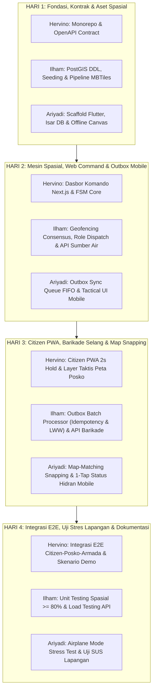

# Peta Tugas & Jadwal Kerja 4 Hari (Sprint Roadmap)

> **Proyek:** HydraTact Samarinda — Platform Koordinasi Taktis Pemadaman Kebakaran Permukiman Padat  
> **Durasi:** 4 Hari Kerja Intensif (Sprint MVP KMM AST-PTMA 2026)  
> **Standar Branching & Commit:** Sesuai [CONTRIBUTING.md](file:///C:/Users/Lenovo/Documents/GitHub/HydraTact/CONTRIBUTING.md)  
> **Standar Alur Status:** Sesuai [docs/SOP-Issue-Workflow.md](file:///C:/Users/Lenovo/Documents/GitHub/HydraTact/docs/SOP-Issue-Workflow.md)  

---

## 👥 Tim & Pembagian Peran

| Anggota Tim | Peran Utama | Fokus Tanggung Jawab |
| :--- | :--- | :--- |
| **Hervino Islami Fasha** (`@hervino`) | *Lead Architect & Fullstack* | Monorepo Setup, OpenAPI Contract, Web Command Center, PWA Citizen, Integrasi E2E |
| **Ilham Ramadhani** (`@ilham`) | *Data & Spatial Backend* | PostgreSQL/PostGIS, DDL 3NF, Pipeline Tippecanoe MBTiles, Algoritma Spasial & FSM API |
| **Ariyadi** (`@ariyadi`) | *UI/UX & Mobile Engineer* | Flutter Android App, Peta Offline MBTiles, Isar DB Outbox Pattern, Ergonomi Taktis |

---

## 📅 Timeline Ringkas 4 Hari

---

## 📋 Rincian Tugas Harian (Task Ledger)

### HARI 1 — Fondasi Arsitektur, Kontrak Data & Aset Peta Offline

| Task ID | Modul | Assignee | Nama Tugas & Branch | Acceptance Criteria / Output | Status |
| :--- | :--- | :--- | :--- | :--- | :---: |
| **HT-101** | `infra` | `@hervino` | `chore/HT-101-monorepo-setup` | Workspace `pnpm` + `Turborepo` berjalan, scripts `lint`, `typecheck`, `test`, `build` terkonfigurasi. | `To Do` |
| **HT-102** | `contract` | `@hervino` | `feat/HT-102-openapi-v3-spec` | Dokumen OpenAPI v3 lengkap di `packages/openapi-contract/` + skrip generator klien TypeScript & Dart. | `To Do` |
| **HT-103** | `database` | `@ilham` | `feat/HT-103-postgis-ddl-migrations` | Container PostgreSQL 16 + PostGIS 3.4 aktif via Docker Compose, skema 3NF dan indeks GiST berhasil dimigrasi. | `To Do` |
| **HT-104** | `spatial` | `@ilham` | `feat/HT-104-samarinda-mbtiles-pipeline` | Ekstraksi OSM Samarinda via Tippecanoe menghasilkan `samarinda_dense.mbtiles` ($\le 45\text{ MB}$, zoom 14-18) + seeding 30 titik air. | `To Do` |
| **HT-105** | `mobile` | `@ariyadi` | `feat/HT-105-flutter-scaffold-isar` | Proyek Flutter Android terinisialisasi, dependensi Isar DB 3.1 & BLoC/Riverpod terpasang dan lolos build. | `To Do` |
| **HT-106** | `mobile` | `@ariyadi` | `feat/HT-106-mbtiles-vector-renderer` | Integrasi `flutter_map_mbtiles`, berkas `.mbtiles` dimuat mulus di layar Android tanpa internet. | `To Do` |

---

### HARI 2 — Mesin Inti Spasial, Dasbor Komando & Antrean Outbox

| Task ID | Modul | Assignee | Nama Tugas & Branch | Acceptance Criteria / Output | Status |
| :--- | :--- | :--- | :--- | :--- | :---: |
| **HT-201** | `web` | `@hervino` | `feat/HT-201-web-command-scaffold` | Shell Next.js 14 Dasbor Komando dengan palet gelap taktis (`#07090E`), kanvas peta Leaflet, tanpa pill chips. | `To Do` |
| **HT-202** | `spatial` | `@hervino` | `feat/HT-202-fsm-lifecycle-engine` | Mesin status insiden deterministik (`PENDING_VERIFICATION` $\rightarrow$ `CLOSED`) di `packages/spatial-core/`. | `To Do` |
| **HT-203** | `backend` | `@ilham` | `feat/HT-203-geofencing-consensus` | Endpoint `POST /api/v1/incidents/report` mengevaluasi konsensus $\ge 2$ warga dalam radius $\le 100\text{ m}$ dan $\Delta t \le 3\text{ mnt}$. | `To Do` |
| **HT-204** | `backend` | `@ilham` | `feat/HT-204-role-dispatching-nearest-water` | Logika Auto-Split peran (`ATTACKER` vs `FEEDER` batas $2.5\text{ m}$) & endpoint pencarian sumber air terdekat (Haversine/GiST). | `To Do` |
| **HT-205** | `mobile` | `@ariyadi` | `feat/HT-205-isar-outbox-sync-queue` | Skema tabel `sync_queue` Isar DB, penyimpanan mutasi lokal dengan `mutation_uuid` dan `client_timestamp`. | `To Do` |
| **HT-206** | `mobile` | `@ariyadi` | `feat/HT-206-tactical-ui-screens` | Antarmuka mode `ATTACKER` & `FEEDER` (target sentuh $56\text{--}64\text{ dp}$, font `tabular-nums`, high contrast). | `To Do` |

---

### HARI 3 — PWA Pelaporan Warga, Barikade Selang & Map-Matching Snapping

| Task ID | Modul | Assignee | Nama Tugas & Branch | Acceptance Criteria / Output | Status |
| :--- | :--- | :--- | :--- | :--- | :---: |
| **HT-301** | `pwa` | `@hervino` | `feat/HT-301-citizen-pwa-haptic-hold` | Portal PWA lapor warga tanpa login: kunci GPS otomatis, tombol tekan-tahan $2.0\text{ detik}$, ukuran aset $< 150\text{ KB}$. | `To Do` |
| **HT-302** | `web` | `@hervino` | `feat/HT-302-live-tactical-map-layers` | Visualisasi waktu nyata titik api, armada relawan, garis barikade selang fuchsia, dan tombol Manual Override posko. | `To Do` |
| **HT-303** | `backend` | `@ilham` | `feat/HT-303-outbox-batch-processor` | Endpoint `POST /api/v1/sync/outbox-batch`: idempotensi transaksi basis data & resolusi konflik Last-Write-Wins (LWW). | `To Do` |
| **HT-304** | `backend` | `@ilham` | `feat/HT-304-hose-barricade-water-status-api` | Endpoint penandaan barikade selang (`LineString`) & pembaruan status air 1-tap (`PATCH /water-sources/{id}`). | `To Do` |
| **HT-305** | `mobile` | `@ariyadi` | `feat/HT-305-client-map-matching-snapping` | Koreksi GPS multipath drift di gang seng rapat: snapping koordinat mentah ke segmen jalan terdekat jika deviasi $\le 25\text{ m}$. | `To Do` |
| **HT-306** | `mobile` | `@ariyadi` | `feat/HT-306-mobile-water-barricade-actions` | Tombol 1-tap status air (`READY`, `LOW`, `EMPTY`), sakelar barikade selang, dan navigasi luring ke hidran. | `To Do` |

---

### HARI 4 — Integrasi E2E, Uji Stres Lapangan, Dokumentasi & Demo KMM

| Task ID | Modul | Assignee | Nama Tugas & Branch | Acceptance Criteria / Output | Status |
| :--- | :--- | :--- | :--- | :--- | :---: |
| **HT-401** | `e2e` | `@hervino` | `feat/HT-401-e2e-integration-scenario` | Alur terpadu tanpa cela: Lapor Warga $\rightarrow$ Auto-Konsensus $\rightarrow$ Notifikasi Posko $\rightarrow$ Dispatch Armada Mobile. | `To Do` |
| **HT-402** | `docs` | `@hervino` | `docs/HT-402-design-and-api-documentation` | Terbitnya `docs/Design.md` (aturan taktis & anti-pill) dan `docs/API.md` (kontrak lengkap titik akhir REST & WS). | `To Do` |
| **HT-403** | `test` | `@ilham` | `test/HT-403-spatial-unit-load-tests` | Unit test algoritma spasial lolos coverage $\ge 80\%$ + load testing 100 request konkuren latensi p95 $< 150\text{ ms}$. | `To Do` |
| **HT-404** | `docs` | `@ilham` | `docs/HT-404-devops-deployment-guide` | Dokumen panduan deployment kontainer Docker & reproduksi pipeline MBTiles di `docs/DevOps.md`. | `To Do` |
| **HT-405** | `mobile` | `@ariyadi` | `test/HT-405-airplane-mode-stress-test` | Pengujian offline fisik Android: peta termuat $< 500\text{ ms}$, antrean Isar DB terkirim utuh saat sinyal pulih. | `To Do` |
| **HT-406** | `docs` | `@ariyadi` | `docs/HT-406-testing-and-sus-evaluation` | Dokumen pengujian lapangan dan instrumen kuesioner System Usability Scale (SUS) target $\ge 75$ di `docs/Testing.md`. | `To Do` |

---

## 🚦 Aturan Eksekusi Harian Tim

1. **Daily Standup Kilat (15 Menit Setiap Pagi):**
   - Apa yang diselesaikan kemarin?
   - Apa target task hari ini?
   - Apakah ada hambatan (*blocker*) dependensi antar modul?
2. **Kepatuhan Alur Git:**
   - Tidak ada kode yang di-push langsung ke `main`.
   - Buka PR dengan template 5W1H segera setelah gate lokal lolos (`lint`, `typecheck`, `test`).
   - Setiap PR wajib di-review sebelum di-merge dengan metode *Squash and Merge*.
3. **Prioritas Blocker Antar Anggota:**
   - Tugas `HT-102` (OpenAPI Contract) dan `HT-103`/`HT-104` (PostGIS & MBTiles) adalah prioritas mutlak Hari 1 agar Hari 2 tidak mengalami *dependency block*.
