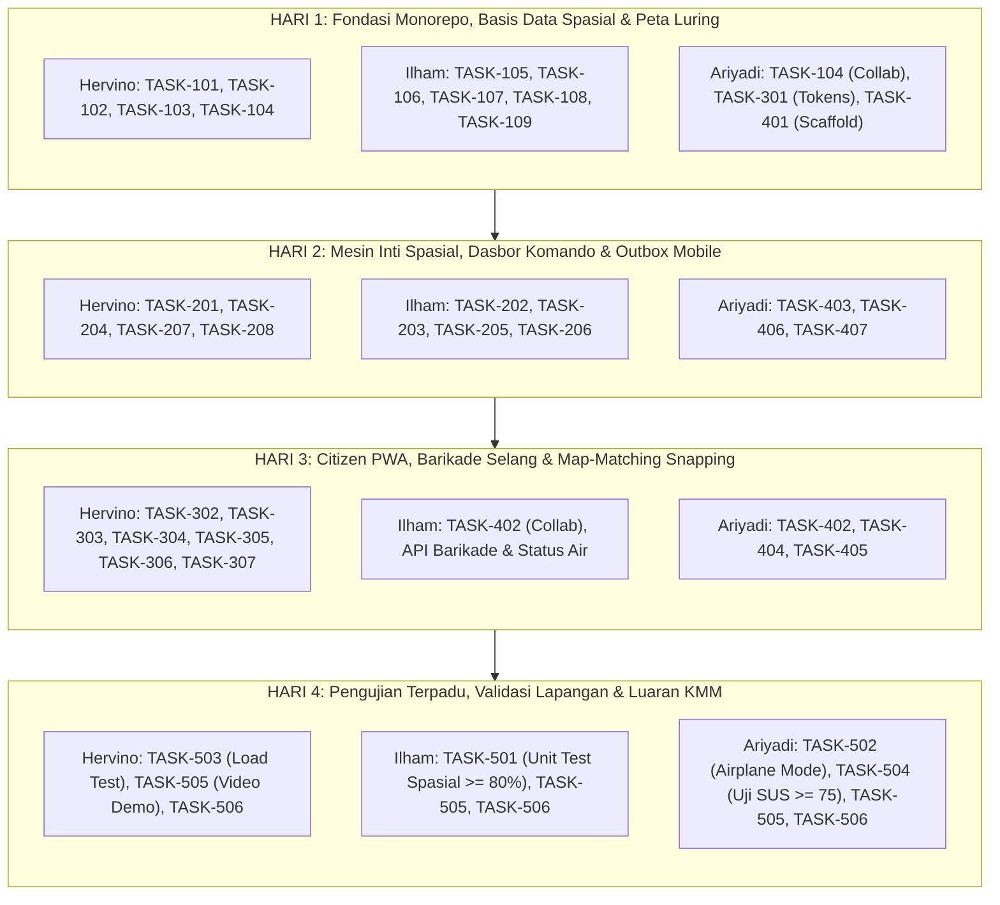

# Peta Tugas & Jadwal Kerja 4 Hari (Sprint Roadmap)

> **Proyek:** HydraTact Samarinda — Platform Koordinasi Taktis Pemadaman Kebakaran Permukiman Padat  
> **Durasi:** 4 Hari Kerja Intensif (Sprint MVP KMM AST-PTMA 2026)  
> **Master Backlog:** Disinkronkan penuh dengan [docs/Task.md](file:///C:/Users/Lenovo/Documents/GitHub/HydraTact/docs/Task.md)  
> **Standar Branching & Commit:** Sesuai [CONTRIBUTING.md](file:///C:/Users/Lenovo/Documents/GitHub/HydraTact/CONTRIBUTING.md) (`<type>/<task-id>-<description>`)  
> **Standar Alur Status:** Sesuai [docs/SOP-Issue-Workflow.md](file:///C:/Users/Lenovo/Documents/GitHub/HydraTact/docs/SOP-Issue-Workflow.md)  

---

## 👥 Tim & Pembagian Peran

| Anggota Tim | Peran Utama | Fokus Tanggung Jawab |
| :--- | :--- | :--- |
| **Hervino Islami Fasha** (`@Hervino`) | *Lead Architect & Fullstack* | Monorepo Setup, OpenAPI Contract, Web Command Center, PWA Warga, Integrasi E2E |
| **Ilham Ramadhani** (`@Ilham`) | *Data & Spatial Backend* | PostgreSQL/PostGIS, DDL 3NF, Pipeline `.mbtiles` Samarinda, Algoritma Spasial & FSM API |
| **Ariyadi** (`@Ariyadi`) | *UI/UX & Mobile Engineer* | Flutter Android App, Peta Luring MBTiles, Isar DB Outbox Pattern, Ergonomi Taktis |

---

## 📅 Pemetaan Sprint ke Timeline 4 Hari

---

## 📋 Rincian Tugas Harian (Task Ledger)

### HARI 1 — Fondasi Monorepo, Basis Data Spasial & Peta Luring

| Task ID | Pri | Modul | Assignee | Nama Tugas & Cabang Branch | Acceptance Criteria / Output | Status |
| :--- | :---: | :--- | :--- | :--- | :--- | :---: |
| **`TASK-101`** | `P0` | `infra` | `@Hervino` | `chore/TASK-101-monorepo-setup` | Workspace `pnpm` + `Turborepo` + Python virtualenv aktif, scripts `lint`, `test`, `build` terkonfigurasi. | `Done` |
| **`TASK-102`** | `P0` | `infra` | `@Hervino` & `@Ilham` | `chore/TASK-102-supabase-local-stack` | Supabase CLI local stack aktif (`supabase init`) untuk PostgreSQL 15/16 + PostGIS 3.4, Auth & Studio. | `To Do` |
| **`TASK-103`** | `P0` | `contract` | `@Hervino` | `feat/TASK-103-pydantic-openapi-spec` | Model Pydantic v2 FastAPI mengekspor dokumen OpenAPI v3 (`openapi.yaml`) untuk seluruh endpoint. | `Done` |
| **`TASK-104`** | `P1` | `contract` | `@Hervino` & `@Ariyadi` | `feat/TASK-104-codegen-ts-dart` | Skrip generate otomatis dari kontrak OpenAPI ke TypeScript client (Web) dan Dart client (Flutter). | `Done` |
| **`TASK-105`** | `P0` | `database` | `@Ilham` | `feat/TASK-105-supabase-postgis-ddl` | Skrip migrasi DDL Supabase PostGIS, tipe ENUM, indeks GiST, dan publikasi replikasi `supabase_realtime`. | `Done` |
| **`TASK-106`** | `P0` | `database` | `@Ilham` | `feat/TASK-106-seeding-samarinda-data` | Seeding `supabase/seed.sql`: posko Balakarcana, 30 titik hidran/tandon, dan skenario uji Jl. Pelita Gg. 4. | `Done` |
| **`TASK-107`** | `P1` | `database` | `@Ilham` | `feat/TASK-107-spatial-queries-gist` | Kueri spasial teroptimasi untuk konsensus radius $\le 100\text{ m}$ dan 3 sumber air aktif terdekat (`<->`). | `Done` |
| **`TASK-108`** | `P0` | `spatial` | `@Ilham` | `feat/TASK-108-osm-samarinda-extract` | Ekstraksi jalan lingkungan dan gang sempit Samarinda dari OpenStreetMap (`.osm.pbf`). | `To Do` |
| **`TASK-109`** | `P1` | `spatial` | `@Ilham` | `feat/TASK-109-tippecanoe-mbtiles` | Kompilasi Tippecanoe zoom 14--18 menghasilkan `samarinda_dense.mbtiles` ($\le 45\text{ MB}$, Jl. Pelita Gg. 4 akurat). | `To Do` |
| **`TASK-301`** | `P0` | `ui/ux` | `@Ariyadi` | `feat/TASK-301-tactical-design-tokens` | Token desain taktis tema gelap (`#07090E` s.d. `#141923`), kontras $\ge 7:1$ (WCAG AAA), angka `tabular-nums`. | `To Do` |
| **`TASK-401`** | `P0` | `mobile` | `@Ariyadi` | `feat/TASK-401-flutter-mbtiles-renderer` | Proyek Flutter Android disiapkan, aset `.mbtiles` terbundel dan dirender via `flutter_map_mbtiles` ($< 500\text{ ms}$). | `To Do` |

---

### HARI 2 — Mesin Inti Peladen, Dasbor Komando & Outbox Mobile

| Task ID | Pri | Modul | Assignee | Nama Tugas & Cabang Branch | Acceptance Criteria / Output | Status |
| :--- | :---: | :--- | :--- | :--- | :--- | :---: |
| **`TASK-201`** | `P0` | `backend` | `@Hervino` | `feat/TASK-201-fastapi-server-core` | Struktur dasar peladen REST FastAPI (Python 3.11+) + Pydantic v2 dengan router asinkron & skema validasi. | `Done` |
| **`TASK-202`** | `P0` | `spatial` | `@Ilham` | `feat/TASK-202-geofencing-consensus` | Mesin konsensus murni di `packages/spatial-core`: evaluasi $\ge 2$ laporan unik ($r \le 100\text{ m}, \Delta t \le 3\text{ mnt}$). | `Done` |
| **`TASK-203`** | `P0` | `spatial` | `@Ilham` | `feat/TASK-203-dynamic-role-dispatching` | Logika Auto-Split peran: `FEEDER` ($\ge 3.000\text{ L}$) vs `ATTACKER` ($< 1.000\text{ L}$) pada jalan $< 2,5\text{ m}$. | `Done` |
| **`TASK-204`** | `P0` | `backend` | `@Hervino` | `feat/TASK-204-incident-lifecycle-fsm` | Incident Lifecycle FSM (`PENDING_VERIFICATION` $\rightarrow$ `CLOSED`) + fitur *Manual Override* posko. | `To Do` |
| **`TASK-205`** | `P0` | `backend` | `@Hervino` | `feat/TASK-205-fastapi-outbox-batch` | Endpoint FastAPI `POST /api/v1/sync/outbox-batch` dengan pengecekan kunci idempotensi (`mutation_uuid`). | `Done` |
| **`TASK-206`** | `P0` | `backend` | `@Ilham` | `feat/TASK-206-last-write-wins-resolution` | Resolusi konflik Last-Write-Wins (LWW) berbasis `client_timestamp` pada status air dan barikade. | `Done` |
| **`TASK-207`** | `P1` | `backend` | `@Hervino` | `feat/TASK-207-supabase-realtime-channels` | Konfigurasi Supabase Realtime CDC Channels untuk siaran instan status insiden, armada, dan barikade. | `To Do` |
| **`TASK-208`** | `P1` | `backend` | `@Hervino` | `feat/TASK-208-rate-limiting-abuse` | Rate limiting (`slowapi`, $3\text{ req/mnt}$ per IP) dan validasi *device fingerprint* pada endpoint pelaporan warga. | `To Do` |
| **`TASK-403`** | `P0` | `mobile` | `@Ariyadi` | `feat/TASK-403-mobile-role-views` | Antarmuka adaptif `ATTACKER` (merah, tombol minta tekanan $64\text{ dp}$) vs `FEEDER` (kuning, parkir & barikade). | `To Do` |
| **`TASK-406`** | `P0` | `mobile` | `@Ariyadi` | `feat/TASK-406-isar-sync-queue-schema` | Skema Isar DB `SyncQueueItem` & `CachedWaterSource` untuk penyimpanan luring perangkat. | `To Do` |
| **`TASK-407`** | `P0` | `mobile` | `@Ariyadi` | `feat/TASK-407-outbox-worker-optimistic` | Optimistic UI dan Background Outbox Worker yang mengirim antrean mutasi (FIFO) saat sinyal pulih. | `To Do` |

---

### HARI 3 — PWA Pelaporan Warga, Dasbor Komando & Map-Matching Snapping

| Task ID | Pri | Modul | Assignee | Nama Tugas & Cabang Branch | Acceptance Criteria / Output | Status |
| :--- | :---: | :--- | :--- | :--- | :--- | :---: |
| **`TASK-302`** | `P0` | `pwa` | `@Hervino` | `feat/TASK-302-citizen-pwa-zero-auth` | Halaman pelaporan warga tanpa login (*Zero-Auth*) dengan kunci geolokasi GPS otomatis. | `To Do` |
| **`TASK-303`** | `P0` | `pwa` | `@Ariyadi` & `@Hervino` | `feat/TASK-303-haptic-press-and-hold` | Tombol darurat Haptic Press-and-Hold ($2,0\text{ detik}$) dengan cincin progres visual dan getar. | `To Do` |
| **`TASK-304`** | `P1` | `pwa` | `@Hervino` | `feat/TASK-304-citizen-consensus-card` | Kartu status konsensus waktu nyata yang mengabarkan verifikasi otomatis kepada warga sekitar. | `To Do` |
| **`TASK-305`** | `P0` | `web` | `@Hervino` | `feat/TASK-305-web-command-leaflet-dark` | Kanvas Leaflet.js tema gelap di Dasbor Posko: titik api, Sungai Karang Mumus, dan sumber air. | `To Do` |
| **`TASK-306`** | `P0` | `web` | `@Hervino` | `feat/TASK-306-auto-split-barricade-panel` | Visualisasi pembagian unit `ATTACKER`/`FEEDER` serta garis barikade selang fuchsia (`LineString`). | `To Do` |
| **`TASK-307`** | `P1` | `web` | `@Hervino` | `feat/TASK-307-telemetry-stream-fsm-ui` | Panel Telemetry Stream kronologis dan tombol kendali transisi status operasi FSM bagi operator. | `To Do` |
| **`TASK-402`** | `P1` | `mobile` | `@Ariyadi` & `@Ilham` | `feat/TASK-402-map-matching-snapping` | Client-Side Map-Matching Snapping untuk mengunci GPS mentah ke gang jika deviasi multipath $\le 25\text{ m}$. | `To Do` |
| **`TASK-404`** | `P0` | `mobile` | `@Ariyadi` | `feat/TASK-404-nearest-water-sources-ui` | Modul 3 Sumber Air Terdekat menggunakan Haversine lokal dan filter status (`READY` / `LOW_DISCHARGE`). | `To Do` |
| **`TASK-405`** | `P0` | `mobile` | `@Ariyadi` | `feat/TASK-405-tap-water-barricade-actions` | Aksi 1-Tap status air dan sakelar Hose Barricade dengan target sentuh ramah sarung tangan ($\ge 48\text{ dp}$). | `To Do` |

---

### HARI 4 — Pengujian Terpadu, Validasi Lapangan & Luaran Kompetisi

| Task ID | Pri | Modul | Assignee | Nama Tugas & Cabang Branch | Acceptance Criteria / Output | Status |
| :--- | :---: | :--- | :--- | :--- | :--- | :---: |
| **`TASK-408`** | `P0` | `e2e` | `@Hervino` | `feat/TASK-408-e2e-integration-flow` | Integrasi alur lengkap: Lapor Warga $\rightarrow$ Auto-Konsensus $\rightarrow$ Posko Induk $\rightarrow$ Dispatch Armada Mobile. | `To Do` |
| **`TASK-501`** | `P0` | `test` | `@Ilham` | `test/TASK-501-spatial-unit-tests` | Unit test algoritma Dynamic Role Dispatching, Haversine, dan FSM (cakupan kode $\ge 80\%$). | `To Do` |
| **`TASK-502`** | `P0` | `test` | `@Ariyadi` | `test/TASK-502-airplane-mode-stress-test` | Pengujian offline fisik Android: simulasikan 10 mutasi luring, restart aplikasi, dan verifikasi sinkronisasi. | `To Do` |
| **`TASK-503`** | `P1` | `test` | `@Hervino` | `test/TASK-503-load-testing-k6` | Load testing 100 permintaan konkuren pada endpoint pelaporan dan sumber air (latensi p95 $< 150\text{ ms}$). | `To Do` |
| **`TASK-504`** | `P1` | `test` | `@Ariyadi` & `@Hervino` | `docs/TASK-504-sus-evaluation-report` | Pengujian System Usability Scale (SUS) 5 skenario bersama 15 relawan Balakarcana (skor $\ge 75$). | `To Do` |
| **`TASK-505`** | `P0` | `media` | `@Semua` | `chore/TASK-505-video-demo-kmm` | Rekam dan edit video demo 5 menit (`04:20`) skenario Jl. Pelita Gg. 4 untuk YouTube panitia KMM. | `To Do` |
| **`TASK-506`** | `P0` | `docs` | `@Semua` | `docs/TASK-506-final-technical-report` | Finalisasi dokumen teknis, repositori publik bersih, dan tautan luaran untuk pengumpulan akhir KMM. | `To Do` |

---

## 🚦 Aturan Eksekusi Harian Tim

1. **Daily Standup Kilat (15 Menit Setiap Pagi):**
   - Apa yang diselesaikan kemarin?
   - Apa target task `TASK-xxx` hari ini?
   - Apakah ada hambatan (*blocker*) dependensi antar anggota?
2. **Kepatuhan Alur Git:**
   - Tidak ada kode yang di-push langsung ke `main`.
   - Gunakan format branch: `<type>/<task-id>-<description>` (contoh: `feat/TASK-101-monorepo-setup`).
   - Buka PR dengan template 5W1H segera setelah gate lokal lolos (`pnpm lint`, `pnpm test`, `pnpm build`).
   - Setiap PR wajib di-review sebelum di-merge dengan metode **Squash and Merge**.
3. **Prioritas Blocker Antar Anggota:**
   - Tugas `TASK-103` (OpenAPI Contract) dan `TASK-105`/`TASK-109` (PostGIS & MBTiles) adalah prioritas mutlak Hari 1 agar pengembangan Hari 2 tidak mengalami *dependency block*.
