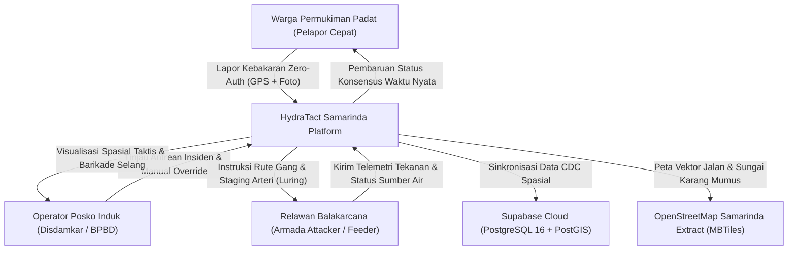
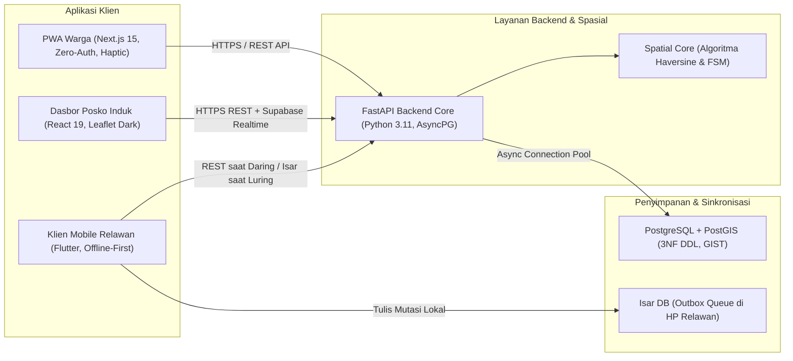
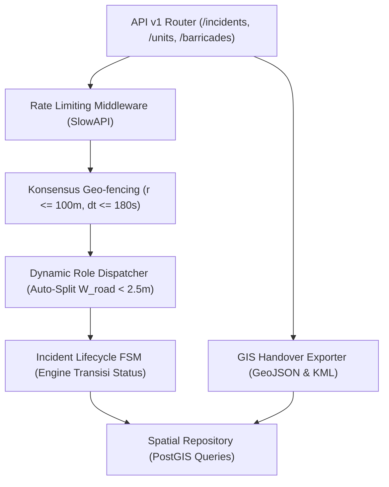

# Spesifikasi Arsitektur C4 HydraTact Samarinda

> **Dokumen Teknis:** Model Arsitektur Berjenjang (Context, Container, Component)  
> **Target Pengguna:** Relawan Damkar Balakarcana, Operator Posko Induk Disdamkar, Warga Permukiman Padat Samarinda

---

## 1. System Context (Tingkat 1)

Diagram System Context menggambarkan posisi HydraTact di tengah ekosistem penanggulangan kebakaran Kota Samarinda.

---

## 2. Container Diagram (Tingkat 2)

Diagram Kontainer memetakan aplikasi mandiri dan penyimpanan data dalam monorepo HydraTact:

---

## 3. Component Diagram: Backend API Core (Tingkat 3)

Komponen internal FastAPI backend yang menangani siklus hidup insiden:

---

## 4. Karakteristik Ketahanan Luring (*Offline-First*)

1. **Client-Side Map-Matching Snapping:**
   - Deviasi multipath GPS $\le 25\text{ meter}$ langsung diproyeksikan tegak lurus ke garis tengah gang permukiman tanpa memerlukan panggilan API jaringan.
2. **Outbox Pattern FIFO:**
   - Mutasi status air, permintaan tekanan pompa, dan laporan barikade disimpan di tabel antrean Isar lokal jika jaringan GSM blank spot.
   - Background worker menyinkronkan antrean secara otomatis dengan strategi *Last-Write-Wins* saat sinyal seluler pulih.
