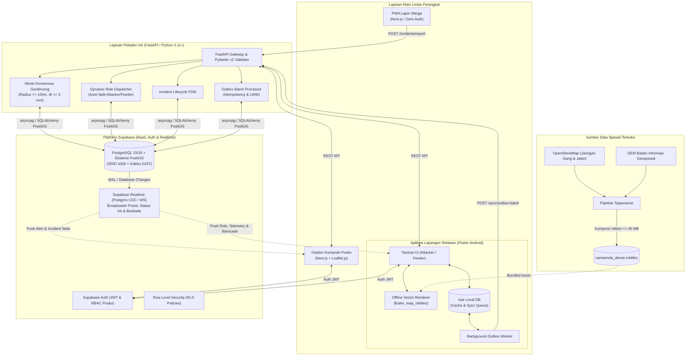
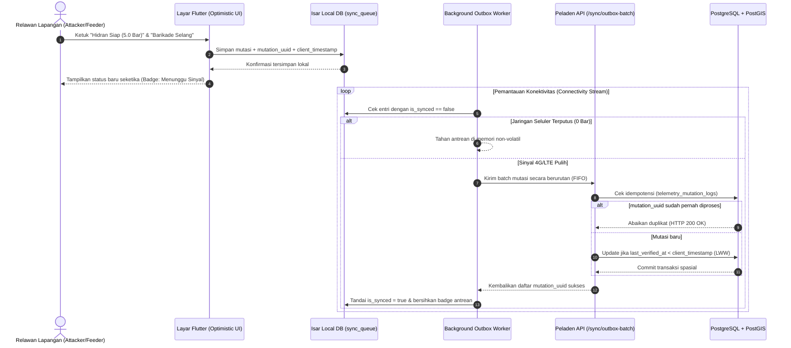
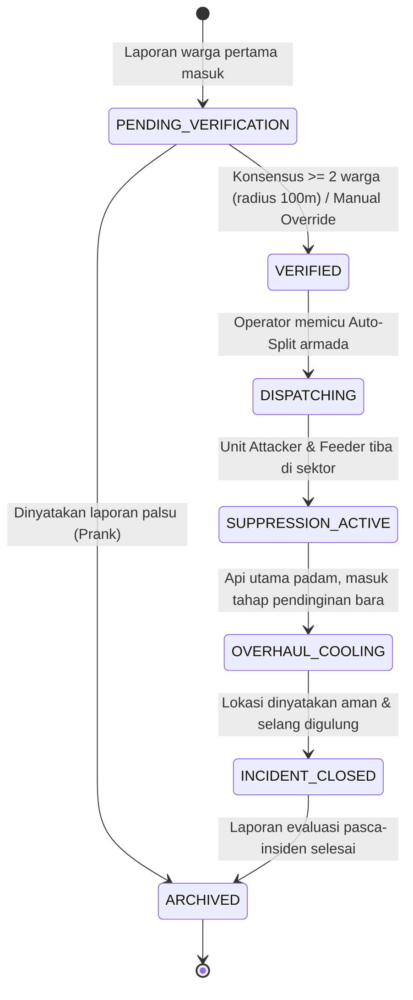

# DOKUMENTASI ARSITEKTUR SISTEM (SYSTEM ARCHITECTURE)

**Nama Produk:** HydraTact Samarinda  
**Versi Dokumen:** 1.0.0 (MVP KMM AST-PTMA 2026)  
**Tim Pengembang:** Hervino Islami Fasha, Ilham Ramadhani, Ariyadi  
**Institusi:** Program Studi Teknik Informatika, Universitas Muhammadiyah Kalimantan Timur (UMKT)

---

## 1. Filosofi & Prinsip Desain Arsitektur

Arsitektur **HydraTact Samarinda** dirancang khusus untuk mengatasi kondisi ekstrem operasi pemadaman kebakaran di kawasan permukiman padat berlorong sempit (lebar jalan $< 2,5\text{ m}$) di bantaran Sungai Karang Mumus. Seluruh keputusan teknis bertumpu pada empat pilar utama:

1. **Zero-Hardware Dependency (Murni Perangkat Lunak):**  
   Sistem tidak bergantung pada pemasangan sensor fisik IoT pada hidran maupun perangkat pelacak GPS khusus di truk relawan. Seluruh telemetri memanfaatkan sensor bawaan ponsel pintar personel dan data spasial terbuka (OpenStreetMap & DEM Badan Informasi Geospasial).
2. **Offline-First & Optimistic UI:**  
   Gang sempit beratap seng rapat sering menyebabkan hilangnya sinyal seluler (*blank spot*). Aplikasi mobile menyimpan peta vektor lokal (`.mbtiles`) dan antrean mutasi lokal (*Outbox Pattern*) sehingga antarmuka tetap merespons dalam $< 100\text{ ms}$ tanpa koneksi internet.
3. **Contract-Driven Monorepo:**  
   Seluruh kode sumber Web, Mobile, dan Backend dikelola dalam satu repositori terpadu (`pnpm` + `Turborepo`) yang terikat oleh satu kontrak **OpenAPI v3** untuk mencegah ketidaksesuaian skema data antarplatform.
4. **High-Stress Tactical Ergonomics:**  
   Antarmuka dirancang dengan palet gelap kontras tinggi (rasio kontras $\ge 7:1$, standar WCAG AAA) dan target sentuh besar ($48\text{ dp}$ hingga $64\text{ dp}$) agar dapat dioperasikan dengan tangan basah atau bersarung tangan pemadam di tengah asap.

---

## 2. Topologi & Diagram Arsitektur Menyeluruh

Sistem terdiri dari tiga klien utama yang terhubung ke peladen FastAPI (Python) untuk kalkulasi bisnis intensif, serta langsung memanfaatkan Supabase Realtime (Websocket / Postgres CDC) dan Supabase Auth:



---

## 3. Struktur Monorepo & Stack Teknologi

### 3.1 Tata Letak Direktori (`pnpm` + `Turborepo` + Python)

```text
hydratact-samarinda/
├── apps/
│   ├── backend-api/         # Peladen REST & Logika Spasial (FastAPI + Pydantic v2 + Python 3.11+)
│   ├── web-command/         # Dasbor Komando Posko Induk (Next.js 14 + Tailwind + Leaflet)
│   ├── pwa-citizen/         # Portal Pelaporan Darurat Warga (Next.js 14 PWA)
│   └── mobile-volunteer/    # Aplikasi Android Lapangan (Flutter + Isar DB + Supabase Flutter)
├── packages/
│   ├── openapi-contract/    # Spesifikasi OpenAPI v3 (diekspor otomatis dari FastAPI) & client TS/Dart
│   └── spatial-core/        # Algoritma spasial murni & model matematis (Haversine, FSM, Auto-Split)
├── supabase/
│   ├── migrations/          # Skrip DDL PostgreSQL + PostGIS, RLS, & trigger replikasi Realtime
│   ├── seed.sql             # Data awal 30 titik hidran/tandon & posko Balakarcana Samarinda
│   └── config.toml          # Konfigurasi Supabase CLI lokal
├── infra/
│   ├── tiles-pipeline/      # Skrip ekstraksi OSM & pipeline Tippecanoe samarinda_dense.mbtiles
│   └── docker-compose.yml   # Orkestrasi kontainer Supabase local stack & FastAPI development
├── package.json
└── turbo.json
```

### 3.2 Ringkasan Pemilihan Teknologi

| Komponen | Teknologi | Justifikasi Arsitektural |
| :--- | :--- | :--- |
| **Peladen API** | Python 3.11+ + FastAPI + Pydantic v2 | Performa asinkron tinggi, integrasi komputasi data spasial murni, validasi payload ketat, dan auto-generate OpenAPI v3 schema. |
| **BaaS & Basis Data Spasial** | Supabase (PostgreSQL 15/16 + PostGIS) | Dukungan penuh tipe geografis PostGIS `GEOGRAPHY(Point, 4326)`, indeks spasial GiST, Row Level Security (RLS), dan Supabase Auth terpadu. |
| **Saluran Waktu Nyata** | Supabase Realtime (CDC WebSocket) | Replikasi perubahan baris basis data langsung ke Web & Mobile tanpa perlu mengelola broker kustom WebSocket terpisah. |
| **Dasbor Komando & PWA** | Next.js 14 + Tailwind CSS + Leaflet.js | *Rendering* peta vektor ringan dengan tema gelap kustom, koneksi Supabase Realtime client, dan ukuran bundel PWA sangat kecil ($< 150\text{ KB}$). |
| **Aplikasi Mobile** | Flutter 3.x (Dart) | Performa rendering kanvas peta $60\text{ fps}$, integrasi `supabase_flutter` & `flutter_map_mbtiles`, serta penyimpanan lokal Isar DB. |
| **Penyimpanan Luring** | Isar DB + `.mbtiles` (SQLite Vector) | Operasi baca-tulis asinkron super cepat di Android serta penyimpanan petak peta vektor lokal dalam satu berkas portabel. |

---

## 4. Arsitektur Offline-First & Mekanisme Sinkronisasi Outbox

Untuk mencegah hilangnya pembaruan status hidran atau penandaan barikade jalan saat relawan memasuki gang tanpa sinyal seluler, aplikasi mobile menerapkan **Transactional Outbox Pattern** yang dipadukan dengan **Optimistic UI**.

### 4.1 Alur Kerja Sinkronisasi & Resolusi Konflik



### 4.2 Jaminan Konsistensi Data

1. **Idempotensi Transaksi:** Setiap aksi pengguna membangkitkan `mutation_uuid` versi 4 di sisi klien. Jika koneksi terputus tepat sebelum perangkat menerima respons HTTP 200 dari peladen, pengiriman ulang pada siklus berikutnya tidak akan menggandakan catatan mutasi.
2. **Resolusi Konflik *Last-Write-Wins* (LWW) Berbasis Waktu Klien:** Jika Regu A memperbarui status hidran pukul `20:10` (offline) dan Regu B memperbarui hidran yang sama pukul `20:12` (offline), namun perangkat Regu A baru mendapat sinyal pukul `20:20`, peladen tetap mempertahankan data Regu B karena membandingkan nilai `client_timestamp`, bukan waktu tibanya paket di peladen.

---

## 5. Mesin Inti & Algoritma Spasial

### 5.1 Konsensus Geospasial Anti-Prank (*Geofencing Consensus*)

Saat warga menahan tombol darurat selama $2,0\text{ detik}$ pada PWA, peladen mengevaluasi kepadatan laporan di sekitar titik koordinat $(\phi, \lambda)$ menggunakan fungsi PostGIS `ST_DWithin` dalam radius $r \le 100\text{ meter}$ dan jendela waktu $\Delta t \le 3\text{ menit}$:

$$
\text{Status}(\text{Incident}) = \begin{cases} 
\text{VERIFIED}, & \text{jika } \left| \{ R_k \mid d(R_k, E) \le 100\text{ m} \;\land\; |t_k - t_0| \le 180\text{ s} \} \right| \ge 2 \\
\text{PENDING\_VERIFICATION}, & \text{jika jumlah pelapor unik} = 1
\end{cases}
$$

Apabila hanya terdapat 1 pelapor (misalnya kejadian tengah malam saat warga tertidur), operator posko tetap dapat melakukan eskalasi langsung melalui tombol **Manual Override (`Verifikasi Paksa`)** setelah melakukan panggilan verifikasi cepat 1-klik.

### 5.2 Algoritma *Dynamic Role Dispatching* (*Auto-Split*)

Untuk mengeliminasi fenomena *traffic gridlock* di mulut gang sempit Kota Samarinda, sistem membagi tugas setiap armada $U_i$ berdasarkan lebar jalan masuk ($W_{\text{road}}$) dan kapasitas tangki air armada ($C(U_i)$):

$$
\text{Role}(U_i) = \begin{cases} 
\text{FEEDER}, & \text{jika } W_{\text{road}} < 2,5\text{ m} \;\land\; C(U_i) \ge 3.000\text{ L} \\
\text{ATTACKER}, & \text{jika } W_{\text{road}} < 2,5\text{ m} \;\land\; C(U_i) < 1.000\text{ L} \\
\text{RESERVE\_FEEDER}, & \text{jika } W_{\text{road}} < 2,5\text{ m} \;\land\; 1.000\text{ L} \le C(U_i) < 3.000\text{ L} \\
\text{DIRECT\_ATTACK}, & \text{jika } W_{\text{road}} \ge 2,5\text{ m}
\end{cases}
$$

* **Unit `FEEDER`:** Diinstruksikan berhenti di jalan arteri utama (lebar $\ge 6\text{ m}$) untuk bertindak sebagai stasiun pompa estafet dan pengumpan air.
* **Unit `ATTACKER`:** Diinstruksikan menerobos masuk ke lorong sempit menuju titik api dengan suplai selang bertekanan dari unit `FEEDER`.

### 5.3 Siklus Hidup Insiden (*Finite State Machine*)

Pengendalian tahap operasi di Dasbor Komando diatur secara deterministik menggunakan *Finite State Machine* (FSM) untuk mencegah lompatan status yang tidak valid:



### 5.4 *Client-Side Map-Matching Snapping* (Mitigasi *GPS Multipath Drift*)

Di dalam gang sempit yang diapit bangunan kayu dan atap seng rapat, sinyal satelit GPS sering memantul (*multipath error*) sehingga titik lokasi unit `ATTACKER` dapat melenceng sejauh $15\text{–}30\text{ meter}$ ke gang sebelah.

Untuk mengatasi hal ini, klien Flutter menjalankan koreksi geometri lokal terhadap jaringan garis jalan (`LineString`) di dalam berkas `.mbtiles`:
1. Hitung jarak tegak lurus terdekat ($d_{\perp}$) dari koordinat mentah GPS $P_{\text{raw}}$ ke segmen jalan lingkungan terdekat $S_j$.
2. Jika $d_{\perp} \le 25\text{ meter}$, proyeksikan titik koordinat ke segmen jalan tersebut ($P_{\text{snapped}} = \text{Project}(P_{\text{raw}}, S_j)$) sebelum ditampilkan di peta dan dikirim ke peladen.

---

## 6. Pipeline Peta Vektor Luring (`.mbtiles`)

Agar aplikasi lapangan dapat memuat peta detail gang Kota Samarinda tanpa kuota internet dan tetap hemat ruang penyimpanan perangkat relawan, tim membangun *pipeline* pra-pemrosesan peta sebagai berikut:

1. **Ekstraksi Geometri:** Mengunduh data mentah jaringan jalan (`highway=residential`, `living_street`, `footway`, `alley`), badan air Sungai Karang Mumus, dan kontur wilayah Kota Samarinda dari OpenStreetMap (`.osm.pbf`).
2. **Pemangkasan Atribut:** Menghapus tag metadata yang tidak relevan untuk operasi pemadaman guna menekan ukuran berkas hingga $> 70\%$.
3. **Kompilasi Petak Vektor:** Menggunakan utilitas **Tippecanoe** untuk menghasilkan berkas `samarinda_dense.mbtiles` dengan rentang pembesaran (*zoom level*) **14 hingga 18** dan batas ukuran akhir **$\le 45\text{ MB}$**.
4. **Distribusi Bundel:** Berkas `.mbtiles` disematkan langsung ke dalam direktori aset aplikasi Android (`assets/maps/`) dan diperbarui secara berkala melalui mekanisme *over-the-air map patch* saat perangkat terhubung ke Wi-Fi posko.

---

## 7. Keamanan, Reliabilitas, & Topologi Deployment

* **Perlindungan Penyalahgunaan API (*Anti-Spam & Rate Limiting*):**  
  Titik akhir publik pelaporan warga (`POST /api/v1/incidents/report`) dibatasi maksimal $3\text{ permintaan/menit}$ per alamat IP dan dikombinasikan dengan sidik jari peramban (*device fingerprint*) agar satu perangkat tidak dapat memanipulasi skor konsensus spasial secara mandiri.
* **Otentikasi Berbasis Peran (RBAC) via Supabase Auth:**  
  Dasbor Komando dan Aplikasi Mobile memanfaatkan **Supabase Auth** dengan token JWT yang memuat klaim peran (`COMMANDER`, `VOLUNTEER_ATTACKER`, `VOLUNTEER_FEEDER`) serta afiliasi posko relawan. Aturan **Row Level Security (RLS)** pada Supabase PostgreSQL mengamankan akses data langsung dari klien.
* **Topologi Deployment:**  
  Peladen **FastAPI** dikemas dalam kontainer Docker ringan (Uvicorn worker). Untuk pengembangan lokal, tumpukan **Supabase CLI** mengelola kontainer PostgreSQL/PostGIS, Supabase Studio, Realtime engine, dan Auth. Pencadangan basis data PostGIS dilakukan secara terkelola di Supabase Cloud atau melalui snapshot `supabase db dump`.