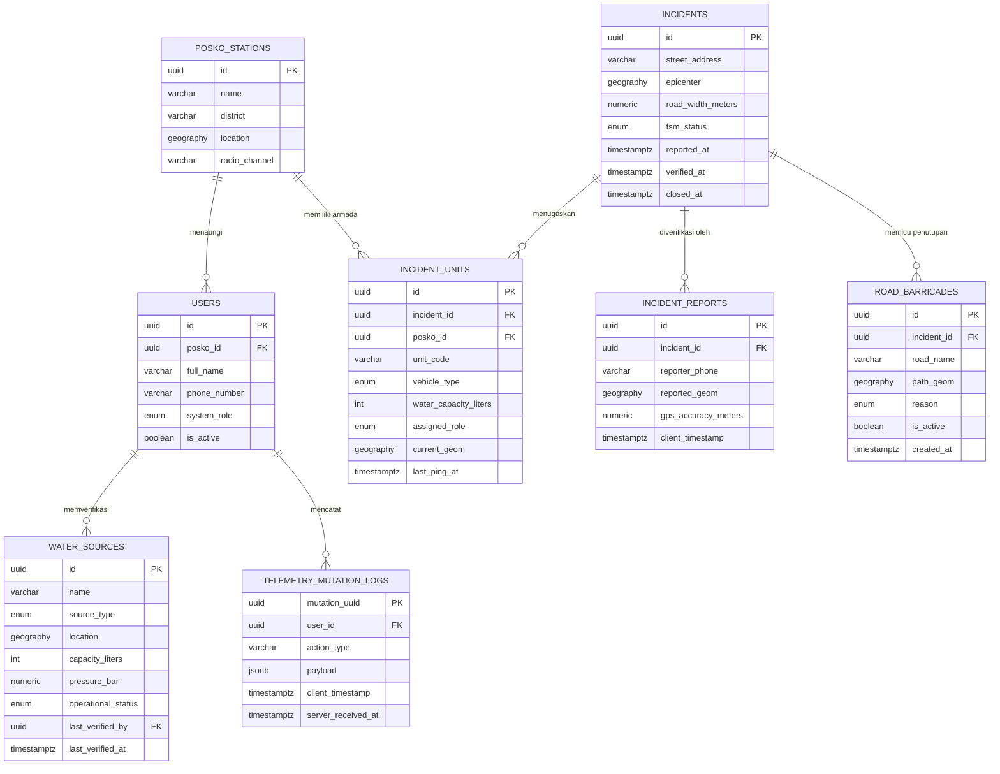

# DOKUMENTASI ARSITEKTUR & SKEMA BASIS DATA (DATABASE SPECIFICATION)

**Nama Sistem:** HydraTact Samarinda  
**Versi Skema:** 1.0.0 (MVP KMM AST-PTMA 2026)  
**DBMS Peladen:** PostgreSQL 16 + Ekstensi PostGIS 3.4 (SRID 4326 / WGS 84)  
**DBMS Klien Mobile:** Isar Database 3.1 (Embedded NoSQL) + Vektor Lokal `.mbtiles`  
**Standar Normalisasi:** Bentuk Normal Ketiga (*Third Normal Form* / 3NF) dengan Indeks Spasial R-Tree (`GIST`)

---

## 1. Arsitektur Penyimpanan Hibrida (*Hybrid Storage Architecture*)

Untuk menjamin keandalan koordinasi pemadaman kebakaran di gang sempit Kota Samarinda yang kerap mengalami kehilangan sinyal seluler (*blank spot*), HydraTact membagi pengelolaan data ke dalam dua lapisan penyimpanan:

1. **Basis Data Spasial Terpusat (PostgreSQL + PostGIS):**
   * Menjadi sumber kebenaran tunggal (*Single Source of Truth*) bagi Dasbor Komando Web dan sinkronisasi lintas posko.
   * Menggunakan tipe data `GEOGRAPHY(Point, 4326)` dan `GEOGRAPHY(LineString, 4326)` agar seluruh kalkulasi jarak (radius konsensus $100\text{ m}$ dan jarak sumber air) dihitung dalam satuan **meter** secara presisi pada kelengkungan bumi.
2. **Basis Data Luring Perangkat Bergerak (Isar DB pada Flutter):**
   * Menyimpan salinan (*cache*) titik sumber air, status insiden aktif, serta tabel antrean mutasi lokal (`sync_queue`).
   * Mendukung pola *Optimistic UI* dan *Outbox Pattern*: setiap pembaruan status hidran atau barikade jalan saat *offline* langsung tersimpan di memori non-volatil ponsel dan dikirim otomatis ke peladen begitu jaringan 4G/LTE pulih.

---

## 2. Diagram Relasi Entitas (*Entity Relationship Diagram*)



---

## 3. Spesifikasi Skema Basis Data Peladen (PostgreSQL + PostGIS)

### 3.1 Definisi Tipe Enumerasi (`ENUM`)

Penggunaan tipe `ENUM` menjaga integritas domain pada mesin *Finite State Machine* (FSM) dan algoritma *Dynamic Role Dispatching*.

```sql
-- Aktifkan ekstensi spasial dan generator UUID
CREATE EXTENSION IF NOT EXISTS "uuid-ossp";
CREATE EXTENSION IF NOT EXISTS "postgis";

-- Status siklus hidup insiden (Finite State Machine)
CREATE TYPE incident_fsm_status AS ENUM (
    'PENDING_VERIFICATION',
    'VERIFIED',
    'DISPATCHING',
    'SUPPRESSION_ACTIVE',
    'OVERHAUL_COOLING',
    'INCIDENT_CLOSED',
    'ARCHIVED'
);

-- Peran pengguna sistem
CREATE TYPE user_system_role AS ENUM (
    'COMMANDER',
    'VOLUNTEER_ATTACKER',
    'VOLUNTEER_FEEDER'
);

-- Klasifikasi jenis kendaraan pemadam relawan
CREATE TYPE fleet_vehicle_type AS ENUM (
    'TANKER_TRUCK',       -- Truk tangki besar (>= 3000 L)
    'PICKUP_SKID',        -- Mobil bak pompa portabel (1000 - 2500 L)
    'THREE_WHEELER_TOSSA',-- Motor roda tiga modifikasi tangki (< 1000 L)
    'PORTABLE_PUMP_SQUAD' -- Regu jalan kaki dengan pompa apung/jinjing
);

-- Hasil keputusan algoritma Dynamic Role Dispatching
CREATE TYPE tactical_unit_role AS ENUM (
    'ATTACKER',
    'FEEDER',
    'RESERVE_FEEDER',
    'DIRECT_ATTACK'
);

-- Jenis titik sumber air Kota Samarinda
CREATE TYPE water_source_category AS ENUM (
    'PDAM_HYDRANT',
    'COMMUNITY_TOWER',
    'RIVER_TIDAL_DOCK',
    'RETENTION_POND'
);

-- Status ketersediaan air waktu nyata
CREATE TYPE water_operational_status AS ENUM (
    'READY',
    'LOW_DISCHARGE',
    'EMPTY',
    'DAMAGED'
);

-- Alasan penutupan / barikade ruas jalan
CREATE TYPE barricade_reason_type AS ENUM (
    'PRESSURIZED_HOSE_LINE',
    'FEEDER_STAGING_ZONE',
    'COLLAPSE_HAZARD'
);
```

---

### 3.2 Tabel Utama & Indeks Spasial (DDL)

#### A. Tabel `posko_stations` (Data Posko Relawan / PMK)
Menyimpan titik pangkal posko relawan swadaya (Balakarcana, PMK, dan Disdamkar Kota Samarinda).

```sql
CREATE TABLE posko_stations (
    id UUID PRIMARY KEY DEFAULT uuid_generate_v4(),
    name VARCHAR(120) NOT NULL,
    district VARCHAR(80) NOT NULL, -- Kecamatan (misal: Samarinda Ilir, Samarinda Ulu)
    location GEOGRAPHY(Point, 4326) NOT NULL,
    radio_channel VARCHAR(30),
    created_at TIMESTAMPTZ NOT NULL DEFAULT NOW()
);

CREATE INDEX idx_posko_location ON posko_stations USING GIST (location);
```

#### B. Tabel `users` (Personel Komando & Relawan)

```sql
CREATE TABLE users (
    id UUID PRIMARY KEY DEFAULT uuid_generate_v4(),
    posko_id UUID REFERENCES posko_stations(id) ON DELETE SET NULL,
    full_name VARCHAR(100) NOT NULL,
    phone_number VARCHAR(20) UNIQUE NOT NULL,
    system_role user_system_role NOT NULL DEFAULT 'VOLUNTEER_ATTACKER',
    is_active BOOLEAN NOT NULL DEFAULT TRUE,
    created_at TIMESTAMPTZ NOT NULL DEFAULT NOW()
);
```

#### C. Tabel `incidents` (Data Kejadian Kebakaran)
Menyimpan titik pusat kebakaran (`epicenter`), parameter lebar jalan masuk (`road_width_meters`), dan status operasi.

```sql
CREATE TABLE incidents (
    id UUID PRIMARY KEY DEFAULT uuid_generate_v4(),
    street_address TEXT NOT NULL,
    epicenter GEOGRAPHY(Point, 4326) NOT NULL,
    road_width_meters NUMERIC(4, 2) NOT NULL DEFAULT 2.00 CHECK (road_width_meters > 0),
    fsm_status incident_fsm_status NOT NULL DEFAULT 'PENDING_VERIFICATION',
    reported_at TIMESTAMPTZ NOT NULL DEFAULT NOW(),
    verified_at TIMESTAMPTZ,
    closed_at TIMESTAMPTZ
);

CREATE INDEX idx_incidents_epicenter ON incidents USING GIST (epicenter);
CREATE INDEX idx_incidents_active_status ON incidents (fsm_status) 
    WHERE fsm_status NOT IN ('INCIDENT_CLOSED', 'ARCHIVED');
```

#### D. Tabel `incident_reports` (Log Laporan Warga untuk Konsensus Geofencing)
Menampung seluruh laporan warga dari PWA tanpa login guna evaluasi klaster radius $r \le 100\text{ m}$ dan selang waktu $\Delta t \le 3\text{ menit}$.

```sql
CREATE TABLE incident_reports (
    id UUID PRIMARY KEY DEFAULT uuid_generate_v4(),
    incident_id UUID REFERENCES incidents(id) ON DELETE CASCADE,
    reporter_phone VARCHAR(20) NOT NULL,
    device_fingerprint VARCHAR(128) NOT NULL, -- Mencegah spam berulang dari 1 perangkat
    reported_geom GEOGRAPHY(Point, 4326) NOT NULL,
    gps_accuracy_meters NUMERIC(6, 2) NOT NULL,
    client_timestamp TIMESTAMPTZ NOT NULL,
    created_at TIMESTAMPTZ NOT NULL DEFAULT NOW(),
    CONSTRAINT uq_device_per_incident UNIQUE (incident_id, device_fingerprint)
);

CREATE INDEX idx_reports_geom ON incident_reports USING GIST (reported_geom);
CREATE INDEX idx_reports_time ON incident_reports (client_timestamp DESC);
```

#### E. Tabel `incident_units` (Penugasan & Telemetri Armada)
Menyimpan daftar armada yang diterjunkan beserta peran hasil kalkulasi *Auto-Split* (`ATTACKER` vs `FEEDER`).

```sql
CREATE TABLE incident_units (
    id UUID PRIMARY KEY DEFAULT uuid_generate_v4(),
    incident_id UUID NOT NULL REFERENCES incidents(id) ON DELETE CASCADE,
    posko_id UUID REFERENCES posko_stations(id) ON DELETE SET NULL,
    unit_code VARCHAR(30) NOT NULL, -- Contoh: ATK-04, FDR-02
    vehicle_type fleet_vehicle_type NOT NULL,
    water_capacity_liters INTEGER NOT NULL CHECK (water_capacity_liters >= 0),
    assigned_role tactical_unit_role NOT NULL,
    current_geom GEOGRAPHY(Point, 4326) NOT NULL,
    last_ping_at TIMESTAMPTZ NOT NULL DEFAULT NOW()
);

CREATE INDEX idx_units_incident ON incident_units (incident_id);
CREATE INDEX idx_units_geom ON incident_units USING GIST (current_geom);
```

#### F. Tabel `water_sources` (Direktori Hidran, Tandon, & Dermaga Sungai)

```sql
CREATE TABLE water_sources (
    id UUID PRIMARY KEY DEFAULT uuid_generate_v4(),
    name VARCHAR(120) NOT NULL,
    source_type water_source_category NOT NULL,
    location GEOGRAPHY(Point, 4326) NOT NULL,
    capacity_liters INTEGER, -- NULL jika sumber air tak terbatas (Sungai Karang Mumus)
    pressure_bar NUMERIC(4, 2) DEFAULT 0.00,
    operational_status water_operational_status NOT NULL DEFAULT 'READY',
    last_verified_by UUID REFERENCES users(id) ON DELETE SET NULL,
    last_verified_at TIMESTAMPTZ NOT NULL DEFAULT NOW()
);

CREATE INDEX idx_water_sources_location ON water_sources USING GIST (location);
CREATE INDEX idx_water_sources_status ON water_sources (operational_status);
```

#### G. Tabel `road_barricades` (Penandaan Selang Melintang Jalan)

```sql
CREATE TABLE road_barricades (
    id UUID PRIMARY KEY DEFAULT uuid_generate_v4(),
    incident_id UUID NOT NULL REFERENCES incidents(id) ON DELETE CASCADE,
    road_name VARCHAR(120) NOT NULL,
    path_geom GEOGRAPHY(LineString, 4326) NOT NULL,
    reason barricade_reason_type NOT NULL DEFAULT 'PRESSURIZED_HOSE_LINE',
    is_active BOOLEAN NOT NULL DEFAULT TRUE,
    created_at TIMESTAMPTZ NOT NULL DEFAULT NOW()
);

CREATE INDEX idx_barricades_geom ON road_barricades USING GIST (path_geom);
```

#### H. Tabel `telemetry_mutation_logs` (Jurnal Idempotensi & Resolusi Konflik)
Mencatat setiap paket yang dikirim oleh *Outbox Queue* perangkat bergerak agar tidak terjadi duplikasi saat sinkronisasi ulang.

```sql
CREATE TABLE telemetry_mutation_logs (
    mutation_uuid UUID PRIMARY KEY, -- Kunci idempotensi dari klien
    user_id UUID REFERENCES users(id) ON DELETE SET NULL,
    action_type VARCHAR(50) NOT NULL, -- UPDATE_WATER_STATUS, TOGGLE_BARRICADE, UNIT_PING
    payload JSONB NOT NULL,
    client_timestamp TIMESTAMPTZ NOT NULL,
    server_received_at TIMESTAMPTZ NOT NULL DEFAULT NOW()
);
```

---

## 4. Skema Basis Data Lokal Perangkat Mobile (Isar DB - Flutter)

Pada aplikasi lapangan Android, seluruh entitas disimpan secara lokal agar aplikasi tetap responsif saat jaringan terputus total.

```dart
import 'package:isar/isar.dart';

part 'local_schema.g.dart';

@collection
class SyncQueueItem {
  Id localId = Isar.autoIncrement;

  @Index(unique: true, replace: true)
  late String mutationUuid;

  late String endpoint;       // Contoh: '/api/v1/water-sources/status'
  late String httpMethod;     // 'PATCH' atau 'POST'
  late String payloadJson;    // Serialisasi JSON muatan data
  late DateTime clientTimestamp;

  @Index()
  bool isSynced = false;

  int retryCount = 0;
  String? lastErrorMessage;
}

@collection
class CachedWaterSource {
  Id localId = Isar.autoIncrement;

  @Index(unique: true, replace: true)
  late String serverId;

  late String name;
  late String sourceType;
  late double latitude;
  late double longitude;
  late String operationalStatus; // READY, LOW_DISCHARGE, EMPTY
  late double pressureBar;
  late DateTime updatedAt;
}
```

---

## 5. Kueri Spasial Kritis & Mekanisme Transaksi

### 5.1 Evaluasi Konsensus Pelaporan Warga ($r \le 100\text{ m}$, $\Delta t \le 3\text{ menit}$)

Kueri berikut dijalankan setiap kali warga menekan dan menahan tombol darurat pada PWA untuk memeriksa apakah sudah ada insiden aktif di sekitar titik koordinat tersebut:

```sql
SELECT 
    i.id AS incident_id,
    i.fsm_status,
    COUNT(r.id) AS total_unique_reports,
    ST_Distance(
        i.epicenter, 
        ST_SetSRID(ST_MakePoint(:lng, :lat), 4326)::geography
    ) AS distance_meters
FROM incidents i
LEFT JOIN incident_reports r ON r.incident_id = i.id
WHERE i.fsm_status IN ('PENDING_VERIFICATION', 'VERIFIED', 'DISPATCHING', 'SUPPRESSION_ACTIVE')
  AND ST_DWithin(
        i.epicenter,
        ST_SetSRID(ST_MakePoint(:lng, :lat), 4326)::geography,
        100.0 -- Radius konsensus 100 meter
      )
  AND i.reported_at >= NOW() - INTERVAL '3 minutes'
GROUP BY i.id
ORDER BY distance_meters ASC
LIMIT 1;
```

### 5.2 Pencarian 3 Sumber Air Aktif Terdekat

Memanfaatkan indeks `GIST` dan tipe `GEOGRAPHY` untuk mengurutkan jarak riil dalam satuan meter:

```sql
SELECT 
    id,
    name,
    source_type,
    operational_status,
    pressure_bar,
    ST_Y(location::geometry) AS latitude,
    ST_X(location::geometry) AS longitude,
    ROUND(
        ST_Distance(
            location, 
            ST_SetSRID(ST_MakePoint(:unit_lng, :unit_lat), 4326)::geography
        )::numeric, 1
    ) AS distance_meters
FROM water_sources
WHERE operational_status IN ('READY', 'LOW_DISCHARGE')
ORDER BY location <-> ST_SetSRID(ST_MakePoint(:unit_lng, :unit_lat), 4326)::geography
LIMIT 3;
```

### 5.3 Resolusi Konflik *Last-Write-Wins* pada Sinkronisasi *Outbox*

Saat dua regu relawan memperbarui status hidran yang sama dalam kondisi luring dan menyinkronkannya pada waktu berbeda, peladen membandingkan `client_timestamp` (waktu kejadian nyata di lapangan) alih-alih waktu tibanya paket HTTP di server:

```sql
UPDATE water_sources
SET 
    operational_status = :new_status,
    pressure_bar = :new_pressure,
    last_verified_by = :user_id,
    last_verified_at = :client_timestamp
WHERE id = :water_source_id
  AND last_verified_at < :client_timestamp; -- Tolak mutasi usang secara otomatis
```

---

## 6. Data Awal (*Seeding*) Wilayah Kota Samarinda

Berikut adalah sampel data spasial awal untuk pengujian skenario simulasi kebakaran di kawasan **Jl. Pelita Gang 4, Kecamatan Samarinda Ilir**:

```sql
-- 1. Seed Posko Relawan Samarinda
INSERT INTO posko_stations (id, name, district, location, radio_channel) VALUES
('11111111-1111-1111-1111-111111111101', 'Posko Relawan Balakarcana Pelita', 'Samarinda Ilir', ST_SetSRID(ST_MakePoint(117.1458, -0.4931), 4326)::geography, '142.850 MHz'),
('11111111-1111-1111-1111-111111111102', 'Posko PMK Swadaya Sungai Dama', 'Samarinda Ilir', ST_SetSRID(ST_MakePoint(117.1512, -0.4985), 4326)::geography, '143.100 MHz');

-- 2. Seed Sumber Air (Hidran PDAM, Tandon Warga, & Dermaga Sungai Karang Mumus)
INSERT INTO water_sources (id, name, source_type, location, capacity_liters, pressure_bar, operational_status) VALUES
('22222222-2222-2222-2222-222222222201', 'Hidran PDAM Jl. Pelita Utama', 'PDAM_HYDRANT', ST_SetSRID(ST_MakePoint(117.1446, -0.4936), 4326)::geography, NULL, 5.00, 'READY'),
('22222222-2222-2222-2222-222222222202', 'Dermaga Hisap Sungai Karang Mumus (Jembatan Lambung)', 'RIVER_TIDAL_DOCK', ST_SetSRID(ST_MakePoint(117.1422, -0.4954), 4326)::geography, NULL, 0.00, 'READY'),
('22222222-2222-2222-2222-222222222203', 'Tandon Komunal RT 14 Gg. 4', 'COMMUNITY_TOWER', ST_SetSRID(ST_MakePoint(117.1439, -0.4945), 4326)::geography, 12000, 1.80, 'LOW_DISCHARGE'),
('22222222-2222-2222-2222-222222222204', 'Hidran PDAM Simpang Lambung Mangkurat', 'PDAM_HYDRANT', ST_SetSRID(ST_MakePoint(117.1475, -0.4962), 4326)::geography, NULL, 0.00, 'EMPTY');

-- 3. Seed Simulasi Insiden Aktif Jl. Pelita Gg. 4 (Lebar Gang 1.8 Meter)
INSERT INTO incidents (id, street_address, epicenter, road_width_meters, fsm_status, verified_at) VALUES
('33333333-3333-3333-3333-333333333301', 'Jl. Pelita Gg. 4 RT 14, Kel. Pelita, Samarinda Ilir', ST_SetSRID(ST_MakePoint(117.1441, -0.4942), 4326)::geography, 1.80, 'SUPPRESSION_ACTIVE', NOW());

-- 4. Seed Penugasan Armada Auto-Split (Attacker vs Feeder)
INSERT INTO incident_units (incident_id, posko_id, unit_code, vehicle_type, water_capacity_liters, assigned_role, current_geom) VALUES
('33333333-3333-3333-3333-333333333301', '11111111-1111-1111-1111-111111111101', 'ATK-04', 'THREE_WHEELER_TOSSA', 600, 'ATTACKER', ST_SetSRID(ST_MakePoint(117.1442, -0.4940), 4326)::geography),
('33333333-3333-3333-3333-333333333301', '11111111-1111-1111-1111-111111111102', 'FDR-02', 'TANKER_TRUCK', 5000, 'FEEDER', ST_SetSRID(ST_MakePoint(117.1445, -0.4935), 4326)::geography);
```