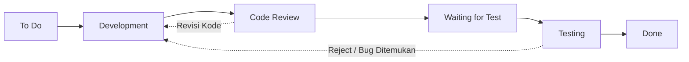

# Standar Operasional Prosedur (SOP) Alur Kerja Issue & Task

> Dokumen ini mengatur transisi status pekerjaan dari tahap perencanaan hingga selesai di repositori **HydraTact Samarinda**. Alur ini wajib diikuti oleh seluruh anggota tim pengembang dan QA.

---

## 1. Peta Tahapan Status (*Issue Lifecycle*)

---

## 2. Rincian & Gerbang Transisi (*Gate Checklist*)

### Tahap 1: `To Do`
* **Definisi**: Issue telah dibuat, diprioritaskan, dan memiliki spesifikasi *Objective & Acceptance Criteria* yang jelas.
* **Tindakan**:
  - Tentukan label prioritas (`P0`, `P1`, `P2`, `P3`) dan platform (`Web`, `Backend`, `Android`, `iOS`).
  - Tentukan penanggung jawab (*Assignee*).
* **Gerbang Keluar ke `Development`**:
  - [ ] Pengembang telah ditugaskan (*assigned*).
  - [ ] Branch baru telah dibuat dari `main` terbaru dengan format `<type>/<issue-id>-<description>` (lihat [CONTRIBUTING.md](file:///C:/Users/Lenovo/Documents/GitHub/HydraTact/CONTRIBUTING.md)).

---

### Tahap 2: `Development`
* **Definisi**: Pengembang aktif menulis kode pada branch terkait.
* **Tindakan**:
  - Menulis implementasi fitur/perbaikan bug sesuai *Acceptance Criteria*.
  - Menulis unit test untuk logika bisnis baru (terutama modul spasial).
* **Gerbang Keluar ke `Code Review`**:
  - [ ] Kode lulus pemeriksaan kualitas lokal tanpa error: `pnpm lint`, `pnpm typecheck`, `pnpm test`, `pnpm build` (atau `flutter test` / `flutter analyze`).
  - [ ] Pull Request telah dibuka ke `main` dengan format **5W1H** ([pull_request_template.md](file:///C:/Users/Lenovo/Documents/GitHub/HydraTact/.github/pull_request_template.md)).
  - [ ] Issue diberi label `status:in-review`.

---

### Tahap 3: `Code Review`
* **Definisi**: PR ditinjau oleh sesama pengembang (*peer-review*) dan **Project Manager (PM)**.
* **Tindakan**:
  - Pemeriksa mengecek kepatuhan arsitektur, efisiensi kueri spasial, keamanan, dan standar penulisan kode.
  - Simulasi merge atau cek potensi konflik hanya boleh dilakukan secara **dry-run** (dilarang eksekusi `git merge` nyata).
* **Gerbang Keluar ke `Waiting for Test`**:
  - [ ] Seluruh diskusi / komentar revisi telah di-resolve.
  - [ ] PR mendapat minimal 1 persetujuan (*Approval*) dari peer-reviewer dan persetujuan dari Project Manager.
  - [ ] Otomatisasi CI di GitHub Actions berstatus hijau.

---

### Tahap 4: `Waiting for Test`
* **Definisi**: Kode sudah disetujui secara teknis dan siap diserahkan kepada tim Quality Assurance (QA).
* **Tindakan**:
  - Pengembang menyiapkan lingkungan pengujian (misal: preview deployment, APK build lokal, atau seed data PostGIS).
  - Informasi akses uji dicantumkan pada komentar issue/PR.
* **Gerbang Keluar ke `Testing`**:
  - [ ] Build atau artefak pengujian siap diakses oleh QA.
  - [ ] Label issue diubah menjadi `status:testing`.

---

### Tahap 5: `Testing`
* **Definisi**: QA melakukan verifikasi fungsional dan pengujian batas (*edge cases*) berdasarkan daftar *Acceptance Criteria*.
* **Tindakan**:
  - Pengujian skenario normal dan ekstrem (misal: simulasi putus sinyal / *Airplane Mode* pada modul offline Isar DB).
  - Jika ditemukan kecacatan (*defect*): QA memberikan catatan penolakan dan mengembalikan issue ke tahap `Development`.
* **Gerbang Keluar ke `Done`**:
  - [ ] Seluruh *Acceptance Criteria* diverifikasi dan dicentang oleh QA.
  - [ ] QA memberikan persetujuan (*QA Approved*) pada komentar PR.

---

### Tahap 6: `Done`
* **Definisi**: PR digabungkan ke branch utama dan issue resmi ditutup.
* **Tindakan**:
  - Project Manager / Tech Lead melakukan **Squash and Merge** ke branch `main`.
  - Branch fitur lokal dan remote dihapus.
  - Issue ditutup secara otomatis melalui kata kunci penutup (`Closes #ID`).
