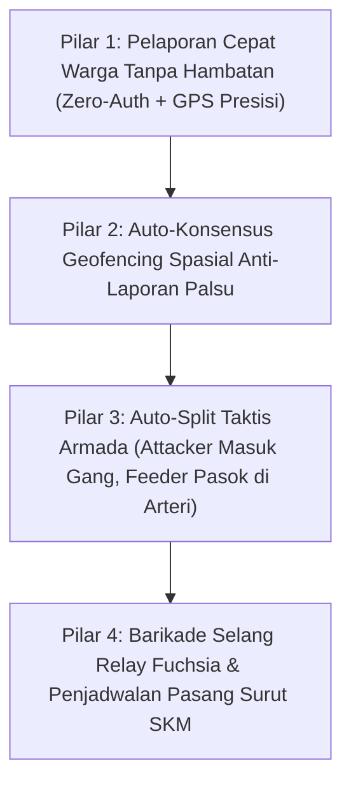

# Kerangka Pengurangan Risiko Bencana (PRB) Kebakaran Samarinda

> **Panduan Lapangan:** Standar Operasional Penanganan Kebakaran Permukiman Padat Pasang Surut  
> **Lokasi Fokus:** Kawasan Tepian Mahakam & Bantaran Sungai Karang Mumus (SKM) Kota Samarinda

---

## 1. Analisis Kerentanan Wilayah Permukiman Padat Samarinda

Kawasan permukiman padat di Samarinda (seperti Jl. Pelita Gg. 4, Selili, Temindung Permai, dan Karang Asam) memiliki karakteristik spasial khusus:

1. **Struktur Bangunan Kayu Ulin:** Mayoritas hunian semi-permanen dengan beban bahan bakar organik tinggi yang mempercepat perambatan api (< 10 menit per blok).
2. **Akses Gang Sempit (< 2.5 Meter):** Kendaraan pemadam utama berkapasitas besar ($\ge 3.000\text{ L}$) terhalang masuk dan berisiko terjebak.
3. **Fluktuasi Pasang Surut Sungai Karang Mumus:**
   - Elevasi pasang optimal ($\ge 1.2\text{ m}$): Pompa apung menyedot debit maksimal $2.800\text{ LPM}$.
   - Elevasi surut kritis ($< 0.2\text{ m}$): Pompa apung berisiko menyedot sedimen lumpur dasar sungai yang menyumbat impeller mesin pompa.

---

## 2. Empat Pilar Taktis HydraTact

---

## 3. Matriks Protokol Tekanan Selang Relay Antar-Unit

Berdasarkan rumus kehilangan tekanan friksi selang:
$$\Delta P = L_{\text{selang}} \times 0.002\text{ bar/meter}$$

| Panjang Selang Relay ($L$) | Tekanan Nozzle Attacker | Estimasi Kehilangan Tekanan | Tekanan Pompa Feeder | Status Operasional |
| :---: | :---: | :---: | :---: | :---: |
| $50\text{ meter}$ | $5.0\text{ bar}$ | $0.10\text{ bar}$ | $5.10\text{ bar}$ | Aman (Jalur Pendek) |
| $100\text{ meter}$ | $5.0\text{ bar}$ | $0.20\text{ bar}$ | $5.20\text{ bar}$ | Aman (Jalur Menengah) |
| $200\text{ meter}$ | $6.0\text{ bar}$ | $0.40\text{ bar}$ | $6.40\text{ bar}$ | Aman (Jalur Gang Dalam) |
| $> 300\text{ meter}$ | $7.0\text{ bar}$ | $> 0.60\text{ bar}$ | $\ge 7.60\text{ bar}$ | Wajib Pompa Booster Tambahan |
